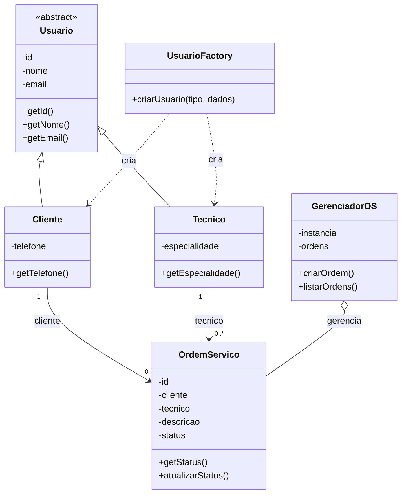

# TechOS Core — Documentação do Projeto

## 1. Objetivo

O TechOS Core é um sistema de gerenciamento de ordens de serviço desenvolvido em JavaScript com Node.js. O projeto aplica Programação Orientada a Objetos (POO) e os padrões criacionais Factory Method e Singleton.

## 2. User Stories — INVEST

### US01 — Abertura de ordem de serviço

Como técnico, quero registrar uma ordem de serviço vinculada a um cliente para acompanhar o conserto de um equipamento.

**Critérios de aceitação:**
- CA01: A ordem deve receber um identificador único.
- CA02: A ordem deve possuir um cliente e um técnico.
- CA03: O status inicial deve ser `ABERTA`.
- CA04: A descrição do serviço deve ser registrada.

### US02 — Consulta de ordem de serviço

Como cliente, quero consultar o status da minha ordem de serviço para acompanhar o andamento do atendimento.

**Critérios de aceitação:**
- CA01: O sistema deve listar as ordens registradas.
- CA02: Cada ordem deve exibir seu ID, técnico, descrição e status.
- CA03: O status apresentado deve corresponder ao estado atual da ordem.

## 3. Requisitos Não Funcionais (RNF)

### RNF01 — Segurança

O sistema deve validar os dados recebidos e evitar a execução de conteúdo não confiável. Caso seja criada uma interface web, as entradas devem ser tratadas contra XSS e outras vulnerabilidades relevantes do OWASP.

### RNF02 — Desempenho

A criação e a consulta de ordens de serviço devem responder em menos de 2 segundos em condições normais de execução local.

## 4. Modelagem Orientada a Objetos

- **Usuario:** classe base abstrata, com ID, nome e e-mail.
- **Cliente:** herda de Usuario e adiciona telefone.
- **Tecnico:** herda de Usuario e adiciona especialidade.
- **OrdemServico:** representa uma ordem, com cliente, técnico, descrição e status.
- **UsuarioFactory:** cria objetos Cliente ou Tecnico conforme o tipo solicitado.
- **GerenciadorOS:** mantém a lista de ordens em uma instância única.

## 5. Diagrama de Classes



## 6. Padrões Criacionais

### Factory Method

A classe UsuarioFactory centraliza a criação de clientes e técnicos, de acordo com o tipo informado.

### Singleton

A classe GerenciadorOS mantém uma instância compartilhada para administrar as ordens de serviço.

## 7. Tecnologias

- JavaScript (ES6 Modules)
- Node.js
- Git e GitHub

## 8. Execução

Com o Node.js instalado, execute:

```bash
node index.js
```

O sistema cria os usuários de demonstração, registra uma ordem de serviço e exibe a lista no terminal.
